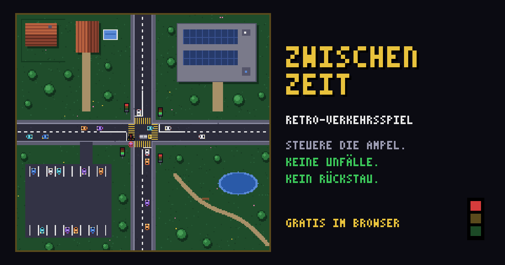

# ZWISCHENZEIT

Retro-Verkehrsspiel im Browser: Du steuerst die Lichtsignalanlage einer Kreuzung und bringst Autos,
Lastwagen, Abbieger und Fussgänger sicher durch. Ohne Unfälle, ohne Rückstau.

**Spielen:** https://zwischenzeit.vercel.app

## Spielprinzip

- Zwei Phasen (Nord-Süd und Ost-West), jeder Wechsel läuft über Gelb und Alles-Rot
- Alles-Rot verlängert sich, bis der Knoten geräumt ist
- Linksabbieger warten im Knoten auf eine Lücke (+2 Punkte), Rechtsabbieger bremsen ab
- Fussgängerphase auf Anforderung, ungeduldige Fussgänger laufen nach 8 s bei Rot
- Ab Level 3 Rotlichtfahrer, der Verkehr wird mit jedem Level dichter
- Game Over nach 3 Unfällen oder 8 s Rückstau am Bildrand
- Online-Rangliste (beste Punktzahl pro Spieler)

## Steuerung

| Aktion | Tastatur | Touch |
|---|---|---|
| Phase wechseln | Leertaste | Knopf oder Tippen aufs Feld |
| Fussgängerphase | F | Knopf FUSSGÄNGER |
| Pause / Neustart / Ton | P / R / M | Knöpfe unten |
| Rangliste / Name | L / N | Knöpfe im Titelbild |

## Technik

- Eine HTML-Datei mit Vanilla JavaScript, Canvas und Web Audio, keine Libraries, kein Build-Schritt
- Pixelgrafik, Pixel-Font und Chiptune-Musik werden zur Laufzeit erzeugt
- Installierbar als Web-App (PWA) und offline spielbar
- Rangliste über Google Apps Script und Google Sheets (`apps-script/Rangliste.gs`)

## Dateien

| Datei | Zweck |
|---|---|
| `index.html` | Das komplette Spiel |
| `config.js` | URL der Rangliste |
| `sw.js`, `manifest.webmanifest`, `icon-*.png` | Web-App und Offline-Betrieb |
| `og-image.png` | Vorschaubild für geteilte Links |
| `robots.txt`, `sitemap.xml` | Suchmaschinen |
| `datenschutz.html` | Datenschutzhinweise |
| `apps-script/Rangliste.gs` | Server-Code der Rangliste (wird nicht veröffentlicht) |

Einrichtung und Veröffentlichung: siehe [ANLEITUNG.md](ANLEITUNG.md).
